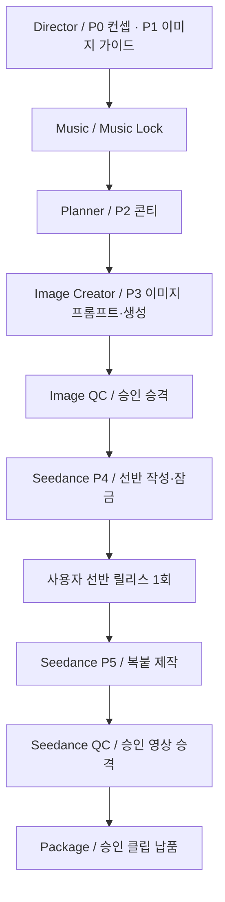

# 영상팀 런타임 규칙 — v5 단일 원본

적용 버전: `2026-10-16-preprod-shelf-v5` (미디어 구조는 v4 유지)

## 0. 권위와 적용 범위

| 순위 | 문서 | 소유 범위 |
|---|---|---|
| 1 | 이 파일 | 레일, lane 순서, 실행 예산, 미디어 구조, 게이트, 안전 |
| 2 | `~/.codex/skills/seedance-prompt-en/` (2.0/기본) 또는 `~/.codex/skills/seedance25-prompt-en/` (사용자가 2.5 명시) | 선택된 버전의 Seedance 제작 프롬프트 규격과 Runway UI 조작 |
| 3 | `~/.codex/video-team-policies/` | 스폰 승인, 브라우저 오퍼레이터 정책 |
| 4 | `videodirector` | 이야기·연출·품질 기준 |

- 같은 규칙을 여러 문서에 복제하지 않는다. 소유 문서 한 곳에만 본문을 두고 나머지는 포인터만 둔다.
- 프로젝트 안에 규칙 사본을 만들지 않는다. 프로젝트 예외는 `docs/project_overrides.md`에 조항 번호와 함께 기록한다.
- 이 v4 미디어 구조는 **이 버전으로 새로 초기화한 프로젝트에만** 적용한다. 기존 프로젝트는 사용자가 별도 이관을 요청하기 전까지 이동·정리하지 않는다.
- No-I2V는 별도 팀이 아니라 이 전체 레일의 `generation_mode=no_i2v_reference_native`다. 달라지는 것은 이미지/레퍼런스 생성 전략과 Seedance 입력 방식뿐이며, 음악·프리프로덕션·QC·media registry·정리·패키지·스폰·안전 규칙은 모두 동일하다.
- 편집(Editor/CapCut) lane은 2026-10-16 퇴역했다. 이 레일은 승인 클립 납품까지만 한다.

## 1. 실행 모델: 프리프로덕션 고정 → 복붙 제작, 기본 직렬



1. 기본 레일은 `director → music → planner → image_creator_01 → image_creator_02 → image_qc → seedance → seedance_qc → package`이다.
2. `next --project <p>`가 반환한 가장 앞의 lane 하나만 실행한다. 여러 lane, 여러 프로바이더, 여러 브라우저를 동시에 돌리지 않는다.
3. **유일한 제작 병렬 예외는 이미지 생성 worker 1~3개**다.
   - 하나의 활성 Image Creator lane이 이미 작성·고정한 프롬프트를 worker에 분배한다.
   - worker는 프롬프트를 수정·재작성·보완하지 않는다.
   - worker는 에이전트가 아니라 수명이 제한된 파일 생성 프로세스이며, fan-in 뒤 종료한다.
   - 4개 이상 요청은 `IMAGE_WORKER_CAP_EXCEEDED`로 거부한다.
4. 같은 owner가 직렬 실행하되 영상 생성은 QC보다 우선한다. 제출 가능한 승인 패키지를 먼저 생성하고, provider 대기 시간에 완료 후보를 QC한다. QC backlog는 독립된 다음 패키지 생성을 막지 않는다. 생성 배치 후 남은 QC를 컷 순서대로 끝내며 승인 승격·납품에는 QC를 유지한다.
5. 프로바이더 기본값은 Seedance다. 명시적인 FLOW 영상 생성 요청은 §1.4의 말포이식 합성 분기로 연결한다. Grok I2V는 사용자가 해당 프로젝트에서 명시했을 때만 같은 직렬 레일 안에서 사용한다. 프로바이더 병렬은 금지한다.
6. **세션 분리(기본):** 메인 대화는 디렉터다. 사용자와 대화·승인·진행 판단만 하고, 레인 작업은 직접 하지 않는다. 다음 레인은 `video-codex-runtime dispatch --project <p> --lanes <lane>`로 **새 Codex 세션**에서 시작하고 `video-codex-runtime wait --project <p> --lane <lane>`로 기다린 뒤 `lanes/<lane>/session_result.json`만 읽는다. 결과가 `NEEDS_USER`면 그 질문을 사용자에게 하고 답(승인 인용)을 기록한 뒤 같은 레인을 다시 dispatch한다. Seedance 제작은 세션당 released 블록 4개다(`PARTIAL`이면 다음 세션).
   - 상시 승인: `session_policy.json`(runtime 루트)에 기록된 사용자 인용 “내가 말한 에이전드 자동생성 금지는, 애가 내가 뭐말할때마다 스킬을 새로 생성해서 에이전트엠디를 무겁게하더라구 그거아니고 세션생성은 괜찮음” (2026-10-17). 이 승인은 레인 세션에만 해당한다.
   - 레인 세션은 한 번에 하나만 돈다(Runway 탭·브라우저 owner 하나). 예외: 브라우저를 쓰지 않는 이미지 레인(`$imagegen`)은 `dispatch --parallel-browserless`로 다른 레인 옆에서 돌 수 있다. 사용자 승인: "런타임 고쳐도 됨" (2026-10-19). 세션 안에서 다른 세션·agent·scheduler·watcher를 만들지 않는다. 백그라운드 daemon, cron, heartbeat, 두 번째 브라우저 자동화 루프는 계속 금지다.
   - 사용자 요청마다 새 스킬이나 AGENTS 문서를 만들거나 늘리지 않는다. 규칙 변경은 기존 문서의 해당 위치를 고친다.
7. 상시 승인이 없으면 `dispatch`는 `--approved-spawn <lane>:<phase>`가 정확히 일치할 때만 실행된다. `next`의 `default_execution.commands`가 다음에 띄울 세션 명령을 알려준다.

### 1.0s 새 프로젝트 시작 (매번 이 순서)

1. 새 영상 요청 = **새 Codex 대화 하나 = 그 프로젝트의 디렉터**. 다른 프로젝트 대화에서 이어 시작하지 않는다.
2. `video-codex-runtime init --slug <영문-slug> --brief "<사용자 요청 원문>" [--mode no_i2v_reference_native] [--author claude|codex]` → 출력된 프로젝트 경로를 쓴다(preprod가 기본). 프로젝트 폴더는 외장 SSD `/Volumes/gnudas-ssd/video-team/projects/`에 생기고(2026-11-10~, 기존 프로젝트는 같은 곳으로 옮기고 옛 경로는 심링크), 편집물은 `/Volumes/gnudas-ssd/video-team/edits/<slug>/`에 둔다. `PROJECTS_SSD_NOT_MOUNTED`면 SSD 연결을 요청하고 로컬에 만들지 않는다. 사용자가 작성 모드를 말하지 않았으면 첫 질문은 “작성 모드: Claude 프롬프팅 / Codex” 하나뿐이다.
3. P0·P1은 디렉터가 이 대화에서 한다(`runtime/templates/director.md`): 컨셉 3안 → 사용자 선택 → 잠금, 스타일 바이블 → 잠금.
4. 그다음은 반복: `video-codex-runtime next --project <p>`의 `default_execution`을 그대로 따른다.
   - `DISPATCH_LANE_SESSION` → `commands[0]` 실행(새 세션 + wait), `session_result`만 읽는다.
   - `ASK_USER` → `show`의 파일을 보여 주고 한 번 묻고, 답을 `commands`로 기록한다(콘티 승인, 선반 릴리스).
   - `LOCK_STAGE` → 그 명령으로 잠근다.
   - `DIRECTOR_IN_MAIN_THREAD` → 디렉터 단계(P0/P1)를 이 대화에서 진행한다.
5. 사용자에게 묻는 곳은 작성 모드, P0 컨셉, P2 콘티, P4 선반 릴리스, 그리고 세션이 돌려준 `NEEDS_USER`뿐이다. 레인 작업·로그·프롬프트·미디어를 메인 대화에서 직접 열거나 하지 않는다.

### 1.0a 불필요한 확인 금지

- 사용자가 요청한 프로젝트 범위의 프롬프트 작성·검수, 승인 참조의 비공개 생성 입력, 설정 확인, Generate, 재시도 규칙 안의 수정, QC, 패키지 정리는 같은 owner가 이어간다. 다음 컷이나 단계마다 “진행할까요?”를 묻지 않는다. **Suno 음악은 예외**: 음악감독은 생성까지만 수행하고 다운로드·생성물 평가/추천/선정은 하지 않는다. 세부 생성 경계는 `music-director/SKILL.md`가 소유한다. Seedance 영상 다운로드 등 다른 매체의 승인된 작업은 이 예외로 바뀌지 않는다.
- Seedance의 같은-turn foreground wait는 매 15분마다 새 승인을 받는 작업이 아니다. 대기와 실제 예약의 구분·진단은 선택된 Seedance skill이 소유한다.
- 실제 scheduler·상주 실행자를 만드는 승인과 결제·로그인·공개 게시·외부 제출·개인정보·비가역 삭제 gate는 그대로다. §1의 레인 세션 상시 승인은 이 gate들을 풀지 않는다.
- 현재 범위에 이미 유효한 명시적 승인이 기록된 작업은 매 파일·컷·QC 정리마다 같은 승인을 다시 묻지 않는다. 승인 밖의 새 surface·비용·공개 동작·다른 파일 삭제로 범위를 넓히지 않는다.
- safe same-tab 새 프로젝트 세션 준비는 Seedance `aside-operator.md`의 구체적 보존·확인 조건을 따른다. 이 파일은 UI 절차를 복제하지 않는다.

### 공통 워크플로우 개선과 예약 적용 범위

- 사용자가 작업 중 “지침 반영”, “워크플로우 수정/개선”을 요청하면 명시적 프로젝트 한정 예외가 아닌 한 `video-team-workflow`의 해당 공통 원본을 수정·검증·배포한다. 프로젝트 메모/증거/래퍼 수정만으로 완료를 보고하지 않는다. 절차: 원본 저장소 `docs/video-feedback-promotion-protocol.md`.
- Seedance 생성 우선·예약 확인·다음 승인 패키지 접수·다운로드·대기 중/배치 후 QC은 모든 프로젝트에 적용되는 공통 절차다. 기본 주기·등록·종료·소비 검증의 단일 원본은 선택된 Seedance skill이 참조하는 shared `seedance-production.md`의 Continuation selection/Post-Generate continuation gate다. 이 파일에 UI/예약 절차를 복제하지 않는다.
- 공통 정책 적용과 예약 인스턴스 생성은 다르다. 각 프로젝트는 자신의 작업/큐에 연결된 승인된 예약을 사용한다. 다른 프로젝트 예약을 재사용하거나 현재 HOLD/PAUSED 작업을 공통 개선 명목으로 재개하지 않는다. 새 surface 승인과 안전 게이트는 유지한다.

### 1.0 입력 증거 게이트

- v4 Planner 진입은 `music.status=LOCKED`만으로 통과하지 않는다. 선택된
  `music.asset_id`(또는 정확한 등록 경로), active locked audio, media 내부 실파일,
  hash, 양수 duration/audio codec 증거가 필요하다. 이전 승인 음악을 재사용할 수
  있으나 누락 증거를 보완하지 않고 새 파일로 가장하지 않는다. 단, 사용자가 해당
  프로젝트에서 **음악 없이 이미지·영상 먼저**를 명시한 경우에는 §1.0b의 증거 잠금
  예외만 Planner 진입을 허용한다.
- Suno 생성 직후에는 `music.status=NOT_LOCKED`, Music lane `PENDING_USER_AUDIO`로
  멈춘다. 생성 ID/링크는 음악 잠금이나 다운로드 허가가 아니다. 사용자가 직접
  선택·다운로드한 파일을 별도 후속 작업으로 제공하기 전에는 자동으로 음악을
  가져오거나 평가·추천·선정하지 않는다. 기존 실파일 Music Lock 검증은 유지한다.
- Image Creator 진입은 비어 있지 않은 `multi_reference_block_map.json`의
  `blocks`, 고유 ID와 cut/shot 구조가 필요하다. 빈 `{}`나 Planner DONE 문자열은
  통과 근거가 아니다. 이 두 v4 입력 실패는 `--force`로 우회하지 않는다.

### 1.0b 명시적 영상 선행·오디오 보류

- 기본 음악 우선은 유지한다. 사용자가 특정 프로젝트에서 음악 작업을 중단하고
  이미지·영상 제작만 지시했을 때만 `manifest.audio_plan.mode=
  visual_only_no_audio`와 `delivery_scope=visual_assets_only`를 사용한다. 승인된
  사용자 메시지 ID·프로젝트 범위·목표 영상 길이·`PROVISIONAL` 타이밍을
  기계 검증해야 한다. 승인 근거와 그 SHA-256은 별도 불변
  `docs/visual_only_authorization.md`에 두고 `docs/project_overrides.md`는
  계속 편집 가능한 예외 설명으로 유지한다. 기존 프로젝트의 전체 overrides 해시는
  명시적으로 이관하기 전까지 레거시 검증한다. 누락·변조·임의 선언은 음악 잠금
  대체 증거가 아니며, 잘못된 예외를 일반 Music 작업으로 되돌리지 않는다.
- 이 예외에서 Music lane은 `PENDING`으로 남고 `next`는 이를 건너뛰어 Planner를
  반환한다. Planner는 브리프의 임시 시간표로 컷/15초 소스 블록을 설계하되 음악
  박자·프레이즈·VO 호흡을 측정했다고 주장하지 않는다. 기존의 블록맵·정체성·참조·
  Seedance attestation·실파일 QC 게이트는 유지한다.
- 음악/VO를 만들지 않았다고 무음 WAV나 상태 `LOCKED`를 위조하지 않는다. 승인된
  실파일로 시각 후보·음악 없는 시각 에셋 패키지를 진행할 수 있다.
  Seedance 영상 안의 장면 인과적 현장음·효과음은 선택된 버전 skill의 Audio 설정을
  따른다. 별도 음악/VO 파일을 만든다는 뜻이 아니다. 패키지는
  `VISUAL_ASSETS_ONLY_NO_MUSIC`으로 명시하고, 음악/VO가 완성된 홍보영상이나
  음악 싱크를 주장하지 않는다. 이는 No-I2V 자동 옵션이 아니라 프로젝트 한정 범위 예외다.

### 1.1 생성 모드

- 기본 `standard_i2v`: 계획된 production cut마다 독립 source/styleframe을 만들고 QC한 뒤 I2V 입력으로 사용한다.
- `no_i2v_reference_native`: **레퍼런스 수와 신규 이미지 생성을 최소화하고, Seedance 제작 프롬프트로 더 많은 shot 구성·blocking·동작·camera·분위기·시간 진행을 해결한다.**
- No-I2V에서도 위의 전체 lane 순서, 최대 3개 이미지 실행 예외, 프로젝트 `media/` 구조, `asset_registry.sqlite`, Music Lock, 프리프로덕션/Seedance/QC/패키지/안전 계약은 바뀌지 않는다. 단, 음악 제외를 사용자가 명시한 프로젝트는 §1.0b가 해당 범위에서 우선한다.
- Planner는 이미 승인·등록된 identity/environment reference를 먼저 재사용한다. 충분하면 신규 이미지는 0개이며, 부족할 때만 최소 provider-safe reference를 만든다.
- No-I2V는 per-cut styleframe/start/end/keyframe을 만들거나 업로드하지 않는다. Reference는 재사용 가능한 identity/environment anchor이고, 최종 제작 prompt가 컷별 구도와 시간적 연출을 담당한다.
- 사용자가 영상팀 진행 중 `No-I2V`를 호출하면 같은 프로젝트의 아직 제출하지 않은 block만 이 모드로 전환한다. 이미 제출된 provider job과 기존 media/provenance는 그대로 보존하며 자동 삭제·재해석하지 않는다.

### 1.2 생성 시간 잠금

- 생성 시간의 선택·변경은 Planner/project workflow가 소유한다. 새 프로젝트의 Seedance 기본 lock은 **15초**다. Seedance 프롬프트 복잡도, 단일 동작 여부, 샷 밀도, final edit trim, Runway의 현재 UI 값으로 시간을 추론하거나 단축하지 않는다.
- Planner는 Seedance handoff 전에 lock을 확인한다. `video-codex-runtime lock-duration`으로 5–14초를 설정하려면 source가 반드시 `user:<evidence>` 또는 `brief:<artifact>`여야 한다. `planner_revision:`은 15초를 재확인하거나 명시적 근거가 반영된 revision을 기록할 수 있지만 혼자서는 단축 권한이 아니다.
- 모든 Seedance pack은 `duration_sec`을 선언하고 `prompt_packet_utils.py attest --project <p>`에서 현재 lock과 일치해야 한다. project 없는 attestation은 제출 권한이 없다.
- **15초는 권고가 아니라 하드 기본값**이다. lock 파일을 수동 편집해 5–14초로 낮추더라도 현재 source가 `user:<evidence>` 또는 `brief:<artifact>`가 아니면 `duration_lock_shorter_without_explicit_user_or_brief`로 gate/attestation/settings verification을 모두 실패시킨다.
- 15초 source의 **사용 가능한 수율**을 우선한다. 한 장면의 카메라·행동·끝 프레임이 좋으면 `SINGLE_CONTINUOUS_SHOT` 하나로 두고 다음 블록으로 이어질 끝 프레임을 확보한다. 사용자 의도와 인과에 맞는 경우에만 연속 컷 2–4개를 `PLANNED_MULTI_SHOT_SOURCE`로 묶는다. 각 scene의 시간, covered cut, reference token, 행동, camera, edit-out을 쓰되 숫자를 채우려고 이질적인 장면을 억지로 묶지 않는다.
- 잠금이 바뀌면 기존 attestation은 무효다. 아직 제출하지 않은 불일치 pack은 `HOLD_DURATION_LOCK_MISMATCH`로 두고 프롬프트의 시간 진행까지 다시 저작·attest한다.
- Runway UI 조작 직전의 visible model+duration 비교 절차는 canonical Seedance skill의 `settings-verify`가 소유한다. 이 파일은 그 UI 절차를 복제하지 않는다.

### 1.3 세션 실행자와 창작 모델 선호

- 실행 모델을 Luna로 고정하지 않는다. 사용자가 고른 현재 세션이 컴퓨터유즈, 이미지 생성 호출, 영상 생성, 다운로드, QC, 폴더링을 맡는다. 실행 native follow-up에는 model/thinking override를 넣지 않는다. 기존 override로 바뀐 세션은 원래 사용자 선택을 확인해야 하며 null을 복귀 증거로 삼지 않는다.
- 기획·이미지·영상의 창작 저작에는 `gpt-6-astra` / `xhigh`를 선호한다. 실행 레인 세션(제작·QC·패키지)은 모델을 지정하지 않아 사용자의 Codex 기본 모델로 돈다. 모델 선호를 별도 agent 생성이나 매 단계 승인 요청의 이유로 삼지 않는다. 실제 저작 모델을 기록하고 Astra가 아닌 결과를 Astra 저작으로 표시하지 않는다.
- 사용자가 특정 산출물에 `Astra만`을 명시했다면 현재 모델이 다를 때 대신 저작하지 않는다. 이때도 자의로 child를 만들거나 일반 제작을 전부 중단하지 않는다. 다른 독립 작업은 계속하고, 해당 산출물만 `HOLD_EXPLICIT_AUTHOR_MODEL`로 남긴다.
- bounded Astra author child는 사용자가 그 **별도 spawn**을 현재 대화에서 역할·목적·산출물까지 특정해 승인한 경우에만 쓰는 선택 경로다. 워크플로우 설치나 일반 “영상팀 실행”은 spawn 승인이 아니다. 승인 없는 상태에서는 child를 제안·요구하는 루틴 체크포인트를 만들지 않는다. 별도 상주 관리자, CLI sidecar, 브라우저 owner, 자동 자기 자신 메시지 전환도 만들지 않는다.
- 호출 준비: `python3 runtime/scripts/author_handoff.py request --project <p> --block <id> --kind planning|image|video --input <project-relative-source> ... --output <owned-output-dir> --approval astra-author:<kind>:<id>`. 이 명령은 native `spawn_agent`용 JSON만 출력하며 모델을 실행하지 않는다. 출력의 실제 model/reasoning_effort/fork_turns 인자를 사용한다. full-history fork 대신 brief·현재 계획·정확한 참조/패키지·거절 피드백의 bounded 파일을 전달한다.
- 승인된 child를 실제 사용하는 경우에만 시작 때 `[아스트라 프롬프팅]`, 복귀 때 `[executor] 세션 모델 유지`를 표시한다. parent는 브라우저를 조작하지 않고 입력 무결성·기존 패키지 상태 등 독립적인 로컬 검증을 수행한 뒤 반환을 기다린다. child는 저작 파일만 수정하고 생성·컴퓨터유즈·추가 spawn을 하지 않는다. Astra-only 요청에서 모델 확인이 안 되면 해당 산출물만 보류하며, 다른 모델의 대행 또는 metadata 이름만 바꾸기는 금지한다.
- 반환 시 parent는 실제 native 호출/반환의 agent 또는 task/turn 식별자·모델 근거와 파일 hash를 기록한다. 자기 선언이나 요청 성공은 저작 완료 증거가 아니다. 관련 skill의 critic/attestation을 통과한 원본 pack을 사용한다.
- 실행 인수증에는 `block_id`, `status=READY_FOR_EXECUTION`, `prompt`, `settings`, `pack`과 순서 있는 `references`를 기록한다. 각 항목은 project-relative `path`와 `sha256`이다. 기존 handoff/attestation에 이 정보를 통합하고 인수 당시 receipt hash를 유지한다. `author_handoff.py verify --project <p> --block <id> --receipt <file> --receipt-sha256 <accepted-hash>`는 파일 무결성만 검증하며 실제 저작 모델·참조 첨부·창작 품질을 증명하지 않는다.
- 실행자는 매 재개 시 다음 block ID와 원본 pack/참조/설정을 다시 읽는다. “두 개씩”은 shelf의 다음 두 eligible block이지 임의 변형 두 개가 아니다. 누락·해시 불일치·다른 block·거절 패키지는 제출하지 않는다. 요약/문장 변경/참조 축소는 저작으로 되돌린다. UI 제출 전 검증·queue-doctor·복구·exactly-once 제출은 선택된 Seedance skill만 소유한다.
- `model_routing.py`의 Astra 저작 경로는 레인 세션의 저작 모델이다. 모델이 비어 있는 레인 세션은 사용자의 Codex 기본 모델을 쓴다. 이미지 lane은 prompting과 production 책임을 구분하되 owner를 강제 분리하지 않는다. 기존 owner 전환 호환 경로는 별도 승인된 경우에만 사용하며 자동으로 Luna를 강제하지 않는다.

### 1.4 명시적 Flow 제작 분기

- 사용자가 FLOW/Flow/플로우로 영상 생성을 요청하면 `flow_malfoy_composite`를
  기획 분기로 선택하고 `~/.codex/skills/videodirector/references/flow-malfoy-composite.md`를
  읽는다. 추가 “말포이식” 호출이나 일반/합성형 선택 질문은 필요하지 않다.
- 기존 기획·오디오·identity·입력 증거·미디어 등록·QC·안전/스폰 게이트는
  유지한다. 코드 BG/FG와 합성 중간 소재는 패키지 자산으로만 납품하며 편집 lane은 없다.
- 활성 Seedance 프로젝트/제출 작업/예약을 자동 전환하지 않는다. 명시적 변경 범위만
  기록하며 기존 HOLD를 보존한다. 영상 생성 요청은 새 owner/병렬/예약 승인이 아니다.
- 이 분기는 현재 **지침 기반 기획·저작 라우팅**이다. 기존 `video-codex-runtime`
  `next`/`dispatch`/attest 및 Runway queue helper는 Seedance 전용이며 Flow 실행
  어댑터가 아니다. Flow를 Seedance로 허위 기록하거나 해당 게이트를 통과했다고
  가장하지 않는다. 실행 착수 전 현재 프로젝트에 맞는 Flow 입력/상태/검증 연결을
  확인·구현하고 시험한다. CLI 연동 미구현은 환경 결함이지 사용자 로그인 문제로 돌리지 않는다.
- 모션그래픽 지식은 위 reference §3을 다른 provider의 관련 기획 단계에서도
  재사용한다. 지식 로딩 자체는 provider 전환이나 모든 영상에 효과 적용을 뜻하지 않는다.

## 2. 프리프로덕션과 프롬프트 소유권

### 2.1 고정 단계 (신규 프로젝트 기본, `preprod/PREPROD_V1`)

모든 창작 결정은 제작 전에 파일로 확정한다. 단계 파일·스키마·잠금은 `runtime/scripts/preprod.py`(`video-codex-runtime preprod <cmd>`)가 소유하고 lane gate가 강제한다.

| 단계 | lane | 파일 | 잠금 |
|---|---|---|---|
| P0 컨셉 | director | `preprod/00_concept/concept_options.md`(3안) → `concept_lock.json` | 사용자 선택 인용 |
| P1 이미지 가이드 | director | `preprod/01_bible/style_bible.json` | lane 검증 |
| P2 콘티 | planner | `preprod/02_storyboard/storyboard.json` | 사용자 승인 인용 |
| P3 이미지 | image_creator · image_qc | `preprod/03_image_prompts/<REF>.prompt.txt`, `image_plan.json` | 모든 ref 승인 등록 |
| P4 영상 프롬프트 | seedance(prompting) | `preprod/04_shelf/<BLOCK>/` | `shelf-lock` + 사용자 `shelf-release` 1회 |
| P5 제작 | seedance(production) | 선반만 소비 | `shelf-verify` 통과 |

- 사용자 확인은 P0 컨셉 선택, P2 콘티(이미지 가이드 요약 포함), P4 선반 릴리스 세 번이다. 그 외 단계 전환마다 묻지 않는다.
- **P5 제작은 빠르게:** 핸드오프 문서로 연 새 Codex 대화에서 `~/.codex/skills/seedance-prompt-en/production-card.md`만 읽고, 블록마다 `runway_ui_helper.py run-block` 한 번 + Generate 클릭 한 번으로 진행한다. 제작 중에는 이 AGENTS·스킬 본문·헬퍼 소스·`--help`·위키를 다시 읽지 않는다(STOPPED 결과가 문서를 지목할 때만). 위키 캡슐·brief·changelog는 배치가 끝난 뒤 한 번 쓴다. 이 예외는 전역 90% 캡슐 규칙보다 우선하지 않는다: 컨텍스트가 실제로 90%에 가까우면 캡슐을 쓴다.

#### 저작 모드 (프로젝트 시작 때 한 번 선택)

| 모드 | 창작 파일(P0–P4) 작성 | Codex가 하는 일 |
|---|---|---|
| `claude` — **Claude 프롬프팅** | Claude Code가 headless로 작성 (`video-codex-runtime author run --stage …`) | 사용자 질문·승인 인용·잠금, 이미지 생성, Runway 제작, QC, registry, 폴더 |
| `codex` — **Codex** | 현재 Codex 세션이 직접 작성 (기존 방식) | 위 전부 + 창작 파일 작성 |

- `authoring_mode`가 `UNSET`이면 director의 첫 질문은 정확히 하나다: “작성 모드: Claude 프롬프팅 / Codex”. 답을 `video-codex-runtime author set-mode --project <p> --mode claude|codex --approval-quote "<사용자 답>"`로 기록한다. `init --author claude|codex`로 미리 정할 수도 있다. 모드가 없으면 P0 잠금이 거부된다.
- `claude` 모드에서 Codex는 창작 파일을 직접 쓰거나 고치지 않는다. 단계마다 `author run --stage concept-options|concept-lock|bible|storyboard|image-prompts|shelf [--block B] [--feedback "<사용자 선택/수정 요청 원문>"]`를 실행하고, 결과 요약과 파일을 사용자에게 보여준 뒤 승인 인용으로 잠근다. 잠금은 파일이 Claude 출력과 바이트 단위로 같을 때만 통과한다(`preprod/authorship.jsonl`).
- `author run`은 메인(디렉터)에서만 돈다(레인 세션 안에서는 `AUTHOR_RUN_IN_LANE`으로 거부, 레인은 `PARTIAL`로 피드백을 돌려준다). Claude 호출은 해당 단계 파일만 쓸 수 있고(`preprod/`의 그 밖의 변경은 `CLAUDE_WROTE_OUTSIDE_STAGE`로 거부, 레인·docs의 동시 쓰기는 무관), 셸·웹·스킬/위키/런타임 쓰기가 막혀 있으며, 검증 오류는 최대 3회 자동 피드백된다. 수정 요청도 `--feedback`으로 다시 Claude에 보낸다.
- 모드 전환은 사용자가 요청할 때만 `set-mode`로 한다. 전환해도 기존 잠금은 유지되고, 이후 작성분부터 적용된다.
- `claude` 모드는 §1.3의 승인형 Astra child 경로를 대체한다(별도 spawn 승인 불필요: 사용자가 모드를 고른 것이 그 승인이다).
- 상류 파일이 잠금 뒤 바뀌면 그 단계와 하류가 모두 `STALE`이 되고 gate가 닫힌다. 재잠금하면 이전본은 `preprod/_superseded/`로 옮겨지고 현행은 항상 한 벌이다.
- P2 잠금이 `lanes/planner/multi_reference_block_map.json`, `video_attributes.json`을 생성한다. 손으로 쓰지 않는다.
- 제작 중 수정 요청은 소유 단계로 돌아가 고치고 재잠금·재릴리스한다. 제작 단계에서 프롬프트를 쓰거나 고치거나 줄이지 않는다.
- `preprod/`가 없는 기존 프로젝트는 이관 요청 전까지 기존 v4 흐름(§2.2–2.3의 legacy 문장)을 따른다.

### 2.2 이미지

- Image Creator lane이 `image-prompt` 스킬 구조로 **영어** 이미지 프롬프트를 쓴다. 한 reference = 한 프롬프트 = 한 독립 이미지. production grid/contact sheet는 금지.
- 반복 인물은 승인된 모델시트를 먼저 만들고 실제 참조로 첨부한다. 세부 기준은 `runtime/references/character_sheet_prompt_standard.md`가 소유한다.
- 이미지 실행은 현재 owner의 내장 `image_gen` 호출이다. `prepare-image-batch`는 hash-bound 목록만 만들며 process·agent를 실행하지 않는다. 참조 누락을 무참조 생성이나 API로 바꾸지 않는다.
- No-I2V에서는 per-cut frame을 만들지 않고 재사용 가능한 최소 identity/environment reference만 만든다.

### 2.3 Seedance

- 모델 입력 프롬프트는 **영어만** 쓴다. 신규 선반은 다른 언어를 허용하지 않는다(기존 프로젝트의 증거 기반 override 코드는 호환용으로만 남는다).
- 선반 프롬프트는 `preprod shelf-check`가 기계 검사한다: 영어·NFC, Runway 입력 한도 10000자 이하(분량 목표 없음), 첫 줄 `15 seconds, N shots:`/`15 seconds, one continuous shot:`, `Shot k (a-bs):` 표시, 숏별 shot size·angle·camera move·must-include 문구, STYLE·IDENTITY 원문, `@ImageN`이 refs와 정확히 일치, 다른 초 수 언급 금지. 그 뒤 `prompt_packet_utils.attest`를 통과해야 잠긴다.
- 제작은 `paste-prompt --file preprod/04_shelf/<B>/prompt.txt --pack preprod/04_shelf/<B>/pack.json`만 허용된다. 릴리스되지 않았거나 잠금 후 바뀐 선반은 helper가 거부한다.
- 세부 프롬프트 규격(단일 canonical 템플릿)과 Runway UI 절차는 선택된 한 버전 스킬만 따른다. 사용자가 `Seedance 2.5`를 명시하면 `seedance25-prompt-en`, 그 외는 `seedance-prompt-en`. 한 block에서 두 버전을 함께 읽지 않는다.
- Legacy: `lanes/seedance/prompts/` pack을 `attest --project <p>`로 ATTESTED 받은 뒤에만 UI를 조작한다.

### 2.4 속성 기반 위키 지식 선택

- 위키는 창작·매체·카메라·QC 지식 저장소지만 Seedance lane이 전체 위키를 읽어서는 안 된다.
- Director가 프로젝트 `medium/project_type`을 분류하고 Planner가 `lanes/planner/video_attributes.json`에 block별 `shot_roles/cameras/risks/methods/audio`를 기록한다.
- Seedance는 prompt 작성 전에 `video-codex-runtime knowledge-select --project <p> --block <BLOCK>`을 실행한다. 로컬 라우터는 `/Users/gnudas/wiki/_meta/video-knowledge-catalog.json`에서 최대 6개 섹션, 기본 9,000자만 골라 context packet과 hash receipt를 만든다.
- 기본 선택은 hot core + 카메라 구도 core + 현재 2D/3D/실사 매체 profile이며, shot/camera/risk/method/audio 문서는 해당 속성이 있을 때만 추가한다. Mixed는 `mixed` 하나로 뭉개지 않고 실제 component media도 함께 선언해 해당 profile들을 선택한다.
- 창작 지식 내부에서는 사용자 최신 지시와 프로젝트/identity/medium lock을 지킨 뒤, `video-prompting-higgsfield-community-grammar`의 camera-first·시간 동사 chain·motion-preset 물리 번역·필요한 만큼의 물리 단서·명시적 end frame을 일반 camera 참고보다 우선 적용한다. 물리 레이어 수를 형식적으로 채우거나 Community prompt 문장·celebrity/IP·preset ID를 그대로 복사하지 않는다.
- 최종 prompt pack과 attestation은 현재 selection ID/context hash를 가져야 한다. 전체 wiki/raw/archive 자동 읽기, 키워드 stuffing, 모델 검색용 background agent는 금지한다.
- 이 라우터는 로컬 파일 선택기이며 agent·scheduler·RAG service가 아니다. Notion 작업 일지는 진행 상태/결정만 저장하며 이 creative knowledge packet에 자동 주입하지 않는다.

## 3. 프로젝트 미디어 단일 저장소

새 v4 프로젝트의 모든 실제 미디어는 프로젝트의 `media/` 아래에만 둔다.

```text
media/
  01_sources_원본자료/
  02_audio_음악/
  03_characters_캐릭터/
  04_images_candidates_이미지후보/
  05_images_approved_이미지승인/
  06_videos_candidates_영상후보/
  07_videos_approved_영상승인/
  08_edit_편집/        # legacy 프로젝트만; 신규 레일은 사용하지 않음
  09_final_최종본/
  90_work_작업중/
  99_archive_보관함/
```

- `lanes/<lane>/`에는 프롬프트, JSON/JSONL, 로그, QC, 상태, 결과 같은 **메타데이터만** 둔다. PNG/JPG/MP4/MOV/WAV/MP3 등 실제 미디어를 두지 않는다.
- `asset_registry.sqlite`가 모든 미디어의 `asset_id`, `work_item_id`, revision, attempt, parent, SHA-256, 현재 경로, lane/provider/prompt provenance를 관리한다.
- 파일명·컷 번호는 표시용이며 자산 식별자가 아니다. 이동·승격 뒤에도 `asset_id`가 동일성을 유지한다.
- 생성 직후 후보 폴더에 등록하고, QC PASS/WARN_PASS 뒤에만 승인 폴더로 `promote`한다.
- Seedance 다운로드 MP4는 `06_videos_candidates_영상후보`에 등록하고, Seedance QC PASS 뒤 `07_videos_approved_영상승인`으로 승격한다.
- 잠근 음악은 `02_audio_음악`, 납품 package는 `09_final_최종본`에 등록한다.

### 3.0 폴더 규칙 (누락·중첩·병목 방지)

```text
<project>/
  brief.md              # 원 요청 + 현재 잠금 요약만. 변경 이력은 쌓지 않는다
  changelog.jsonl       # 사용자 수정 요청 1줄씩 (시각, 인용, 영향 단계)
  preprod/              # P0–P4 창작 결정의 유일한 위치 (현행 1벌)
    00_concept/ 01_bible/ 02_storyboard/ 03_image_prompts/
    04_shelf/<BLOCK>/{brief.md,prompt.txt,settings.json,refs.json,pack.json,SHELF_LOCK.json}
    locks/  _superseded/<stage>_R<n>/
  media/                # 실제 미디어의 유일한 위치 (registry 등록)
  lanes/<lane>/         # status.json, result.md + 해당 lane 메타데이터만
~/RunwayUpload/<project>/<BLOCK>/   # 업로드용 ASCII clone 번들 (24시간 sweep, 원본 아님)
~/RunwayUpload/_runway_library.json # Runway Uploads에 이미 있는 파일(sha256→표시 이름) 장부. 있으면 업로드하지 않고 선택
```

- 창작 결정(컨셉·룩·콘티·프롬프트)은 `preprod/` 밖에 만들지 않는다. `lanes/<lane>/`에 제안서·버전 폴더(`v42_*`, `*_R12` 사본)를 늘리지 않는다. 개정은 같은 파일을 고치고 재잠금하면 `_superseded/`가 이력을 보관한다.
- 일회성 진단·영수증 JSON은 `lanes/<lane>/receipts/<YYYYMMDD>/`에 둔다. lane 루트는 상태·결과와 helper가 소유한 고정 파일만 둔다.
- 업로드는 항상 helper가 만든 번들 파일만 쓴다. Downloads·/tmp·바탕화면에 사본을 만들지 않는다.

### 3.1 미디어 정규화는 하드 게이트

다음 중 하나라도 있으면 미디어를 소비하는 lane(image_qc, seedance, seedance_qc, package) 실행을 `MEDIA_HARD_GATE`로 거부하며 `--force`로 우회할 수 없다. 기획 lane(director, music, planner, image_creator)은 stray 파일로 멈추지 않지만 `validate`가 문제를 계속 보고한다.

- 실제 미디어가 `media/` 밖에 있음
- `media/` 파일이 registry에 없음
- 등록 파일이 사라졌거나 SHA-256이 달라짐
- 승인 자산이 후보/작업 폴더에 남아 있음
- 하류 lane이 요구하는 등록 후보·승인·최종 자산이 없음

`python3 runtime/scripts/media_registry.py audit --project <p>`가 통과해야 진행한다.

## 4. 24시간 중간 파일 정리

### 4.1 중간 파일

다음은 더 이상 활성·정규 자산이 아님이 registry로 확인된 경우에만 중간 파일이다.

- 업로드/가져오기용 staging 복사본
- 실패·거절된 재시도 결과
- 선택되지 않은 후보
- 정규본이 별도로 존재하는 exact duplicate
- proxy, test output
- 상태가 변하지 않은 중복 증거 screenshot

### 4.2 보호 대상

원본, 사용자 지정 참조, 승인 이미지/영상, 잠긴 음악, 최종 package, `preprod/` 잠금 파일, 프롬프트, manifest, provenance, QC 기록은 자동 정리하지 않는다.

### 4.3 처리 방식

- 중간 파일은 `90_work_작업중`으로 이동하고 `active=0`과 사유를 기록한다.
- 그 상태로 **최소 24시간** 지난 파일만 macOS 휴지통으로 옮긴다.
- 원래 경로, 휴지통 경로, SHA-256, 사유, 시간을 SQLite와 `cleanup_journal.jsonl`에 남긴다.
- 휴지통 전체를 자동으로 비우지 않는다. 일반 파일의 영구 삭제는 금지한다. 사용자가 명시적으로 승인한 QC 임시 사본의 검토 후 영구 삭제만 `runtime/templates/seedance_qc.md`의 소유권·해시·삭제 기록 절차로 처리한다.
- v4 프로젝트에서 `project_sweep.py apply`는 이 registry-backed 정책만 수행한다.
- 별도 정리 daemon을 만들지 않는다. 승인된 lane `dispatch`가 모든 시작 게이트를 통과했을 때만 24시간이 지난 eligible 항목을 동기적으로 휴지통 처리한다.

## 5. Seedance 큐 대기와 재개

- 큐 판정, slot 보충, 다음 패키지 무장, same-turn foreground wait, 재확인, 다운로드 절차는 오직 선택된 버전 스킬의 production 문서와 `scripts/runway_ui_helper.py`를 따른다. 2.0은 `seedance-prompt-en/seedance-production.md`, 명시적 2.5는 `seedance25-prompt-en/production.md`이다. 2.5 helper는 공통 구현의 모델 정책 adapter일 뿐이다. CLI의 timer/file은 Codex를 자동 재진입시키는 scheduler가 아니며, 이 파일은 그 절차를 복제하지 않는다.
- 상주 monitor, `watch-generate`, 별도 observer agent/process, 두 번째 브라우저 루프는 사용하지 않는다.
- 로그인, CAPTCHA, 결제, 권한, 계정 제한은 자동 대기로 해결하지 않는다. 정확한 사용자 행동을 적고 BLOCKED한다.

## 6. 제작·QC 공통 게이트

- 음악 우선: BGM/노래의 구조, 박, 프레이즈, 훅, 에너지, 엔딩을 분석한 뒤 컷 타이밍을 잠근다.
- 반복 인물/캐릭터는 모델시트가 승인·등록·첨부 검증되기 전 production frame을 만들지 않는다.
- 원본 still은 납품 클립으로 넣지 않는다. 승인된 생성 clip만 사용한다.
- QC는 해부학, 손·물체, 인물 소실, 정체성, crop drift, 반복 샷, jitter, freeze, 1-frame flash, subtitle overlap, line clipping, 전환 handle을 확인한다.
- 실패한 클립은 재생성·교체한다(편집으로 숨기지 않는다).
- 실제 파일 경로·크기와, 영상/음악이면 duration·codec을 확인하기 전 완료로 표시하지 않는다.

## 7. 패키지

- 편집 lane은 없다. Package는 `seedance_qc` DONE/PASS 뒤 승인 클립을 이야기 순서대로 `media/09_final_최종본/<project>_package/`에 모은다: 순번 이름의 승인 클립, `clip_order.csv/json`(순서·block·asset_id·sha256·duration·선반 prompt 경로), 잠긴 audio(해당 시), keyframe/contact sheet, notes, 필요한 공개 문구.
- 패키지는 registry에 `--kind package`로 등록한다. 자르기·리타이밍·master 조립은 하지 않는다.

## 8. 안전과 스폰 제한

- 공개 upload/publish, 공모전·정부 form 제출, email send, 개인정보 form submit, payment, password/2FA, 영구 삭제는 명시적 사용자 승인이 필요하다.
- 영상팀에서 별도 agent/lane/subagent/browser loop를 만들려면 현재 대화에서 그 역할·목적·산출물을 명시해 사용자 승인을 받아야 한다.
- 이미지 최대 3개 실행은 §1의 bounded non-agent worker 예외일 뿐, 추가 프롬프트 agent나 browser agent를 허용하지 않는다.
- Seedance 15분 재확인은 §5의 동일 turn foreground wait이며 agent spawn이나 scheduler가 아니다. 대기 결과를 같은 turn이 소비하고 visible board를 재확인하기 전에는 재개 성공으로 인정하지 않는다.
- 문제를 자동으로 고칠 수 있으면 해당 소유 문서의 고정 복구 사다리를 끝까지 수행하고, 해당 항목만 실제 의미 실패하면 다음 적격 항목으로 넘어간다. 특히 Seedance의 도구 timeout·탭 handle 소실·chooser timeout은 업로드 수리 횟수로 차감하지 않으며 선택된 버전 production 문서의 same-session checkpoint 복구 루프를 따른다. 사람·외부 상태가 필요한 문제만 정확한 사용자 행동과 함께 BLOCKED한다.

## 9. 상태·검증 명령

```bash
video-codex-runtime init --mode standard_i2v --brief <brief>          # preprod/ 포함 (legacy: --no-preprod)
video-codex-runtime preprod status --project <p>
video-codex-runtime preprod check --project <p> --stage concept|bible|storyboard|images
video-codex-runtime preprod lock --project <p> --stage <stage> [--approval-quote '<user words>']
video-codex-runtime preprod shelf-brief|shelf-check|shelf-lock|shelf-verify --project <p> --block <B>
video-codex-runtime preprod shelf-release --project <p> --blocks ALL_LOCKED --approval-quote '<user words>'
video-codex-runtime init --mode no_i2v_reference_native --brief <brief>
video-codex-runtime set-mode --project <p> --mode no_i2v_reference_native
video-codex-runtime lock-duration --project <p> --seconds <5..15> --source <user:...|brief:...|planner_revision:...>
video-codex-runtime next --project <p>
video-codex-runtime dispatch --project <p> --lanes <one-lane>          # new lane session (standing session-policy)
video-codex-runtime dispatch --project <p> --lanes seedance --phase production [--blocks B01 B02]   # ≤2 blocks/session (Runway: 2 active generations); harvest when both slots are busy or all generated
video-codex-runtime wait --project <p> --lane <lane> [--timeout-min 10]  # prints session_result; re-run while running
video-codex-runtime session-policy --show
python3 /Users/gnudas/.codex/skills/seedance-prompt-en/scripts/runway_ui_helper.py run-block --project <p> --block-id <B>
python3 /Users/gnudas/.codex/skills/seedance-prompt-en/scripts/runway_ui_helper.py record-generate --project <p> --block-id <B> --state IN_QUEUE
video-codex-runtime model-route [--project <p> --lane seedance --phase auto]
video-codex-runtime dispatch-image-shards --project <p> --lane image_creator_01 --max-parallel 3
python3 runtime/scripts/media_registry.py audit --project <p>
python3 runtime/scripts/media_registry.py cleanup --project <p> --older-than-hours 24 --apply
python3 runtime/scripts/prompt_packet_utils.py attest --project <p> --pack <prompt-pack.json>
python3 /Users/gnudas/.codex/skills/<selected-seedance-skill>/scripts/runway_ui_helper.py prepare-upload-bundle --project <p> --block-id <B> --pack preprod/04_shelf/<B>/pack.json
python3 /Users/gnudas/.codex/skills/<selected-seedance-skill>/scripts/runway_ui_helper.py record-runway-attach --path <bundle-file> --name <name-in-Uploads> --how reused|uploaded|missing
python3 /Users/gnudas/.codex/skills/<selected-seedance-skill>/scripts/runway_ui_helper.py settings-verify --project <p> --block <BLOCK> --visible-model '<visible-model-label>' --duration-sec <visible-seconds>
python3 /Users/gnudas/.codex/skills/<selected-seedance-skill>/scripts/runway_ui_helper.py resume-contract --project <p>
python3 /Users/gnudas/.codex/skills/<selected-seedance-skill>/scripts/runway_ui_helper.py recovery-checkpoint --project <p> --block-id <BLOCK> --session-url <exact-runway-session-url> --reference Image1=<AST_...>
python3 /Users/gnudas/.codex/skills/<selected-seedance-skill>/scripts/runway_ui_helper.py recovery-record --project <p> --block-id <BLOCK> --incident <CODE> [--slot ImageN]
python3 /Users/gnudas/.codex/skills/<selected-seedance-skill>/scripts/runway_ui_helper.py recovery-resolve --project <p> --block-id <BLOCK> [--verified-slot ImageN]
video-codex-runtime validate --project <p>
```

상태·프롬프트·계획·UI 설정만으로 완료를 주장하지 않는다. 실제 미디어와 검증 증거가 완료의 기준이다.

<!-- codex-harness-kit:bridge:start -->
## Codex Harness Activation

This repository uses `codex-harness-kit`.

Keep the existing instructions in this file, and additionally treat `AGENTS.harness.md` as active instructions.

Before making code changes:

1. Read `docs/harness-config.json` first.
2. Use the file paths from the config `paths` object instead of assuming fixed `docs/...` paths.
3. Follow the harness workflow in `AGENTS.harness.md` together with the rest of this file.
<!-- codex-harness-kit:bridge:end -->
